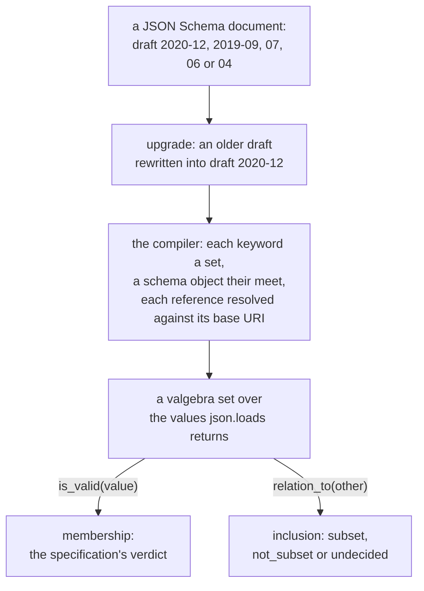
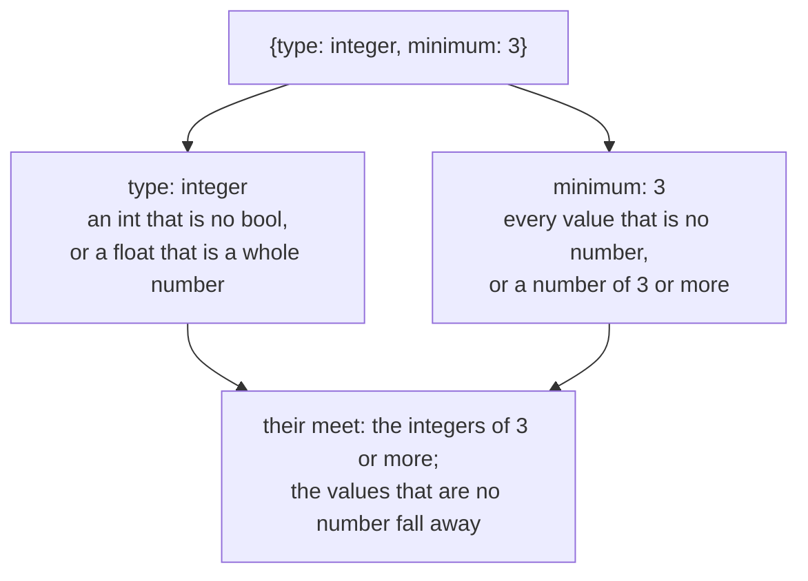
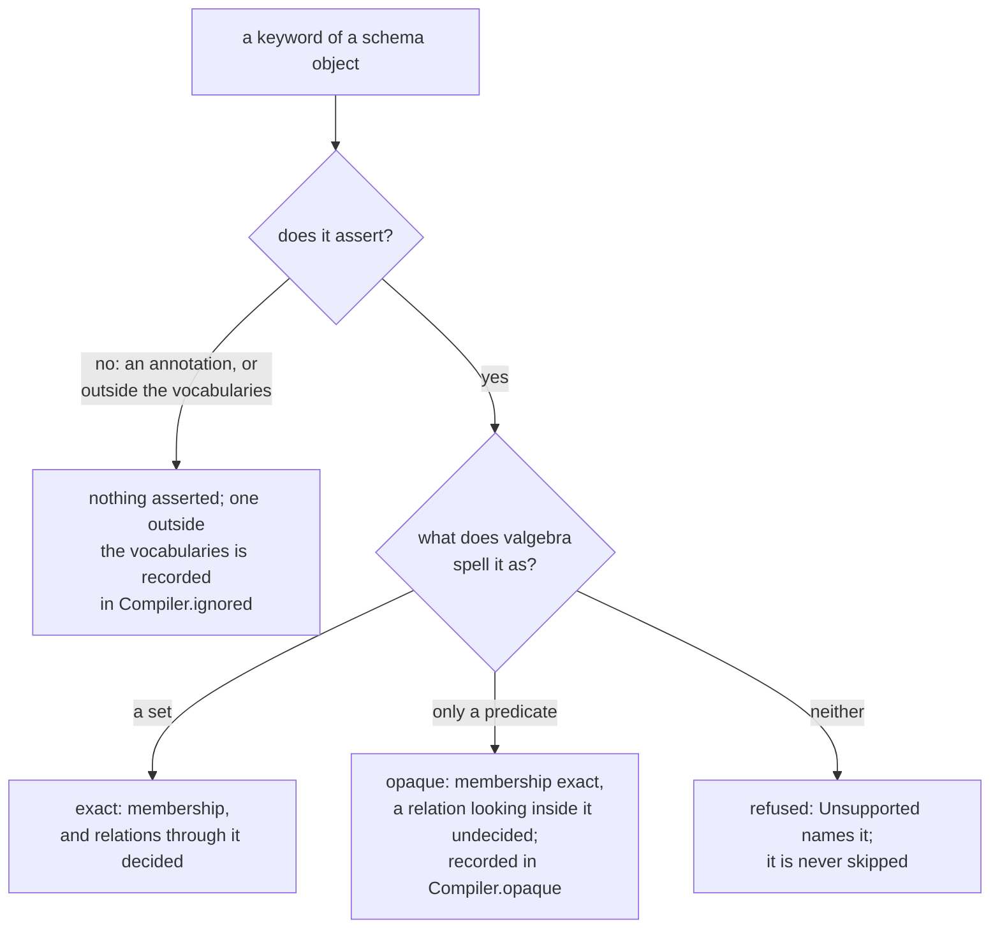
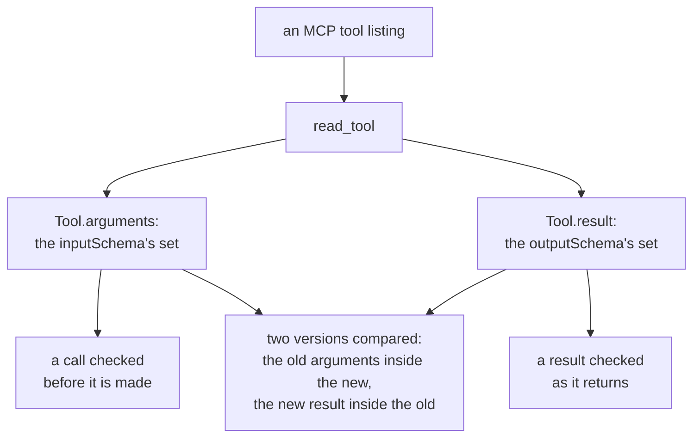

# How it works

A JSON Schema document becomes a valgebra set over the values `json.loads` returns, and the set
answers two questions: whether a value belongs, as the specification states it, and whether
every value one schema admits another admits too. This page follows a schema from its document
to those two answers; [the compiler](compiler.md) states each keyword in full.

## Two questions, one set

A validator answers the first question for one value at a time. The second is about every
value at once, so no run of a validator answers it: which values may a new version of a tool
return that an old client never saw, which arguments did the old version take that the new one
refuses. Here both are asked of one compiled set.

```python
from valgebra_jsonschema import compile_schema

at_least_3 = compile_schema({"type": "integer", "minimum": 3})
integers = compile_schema({"type": "integer"})

# Membership: a value's verdict, as the specification gives it.
assert at_least_3.is_valid(5)
assert not at_least_3.is_valid(2)

# Inclusion: every value of one set in the other, or not.
assert at_least_3.relation_to(integers) == "subset"
assert integers.relation_to(at_least_3) == "not_subset"
```

## From a document to a set



- **The dialect.** A document with no `$schema` is draft 2020-12, as the Model Context Protocol
  states. `compile_schema` rewrites a draft 2019-09, 07, 06 or 04 document by `upgrade` into the
  draft 2020-12 document with the same meaning, and refuses any other dialect.
- **References.** A `$ref` resolves against the base URI it sits under, to the document compiled
  or to one `documents` holds; none is fetched. A schema reaching itself, a tree or a linked
  list, compiles to the recursive set it denotes.
- **The universe.** The values `json.loads` returns: `None`, `bool`, `int`, a `float` that is
  not NaN, `str`, `list` and `dict` with `str` keys, nested. A tuple, a Python set or a
  `datetime` is no JSON value and lies outside every schema.

What the set means, and whether one lies inside another, is
[valgebra](https://ppigazzini.github.io/valgebra/)'s to decide; what a keyword means is the
specification's, and reading it into a set is this package's.

## A keyword is a guarded set

An assertion keyword constrains one kind of value and passes every other kind, and a schema
object holds where each of its keywords does (Attouche et al. 2024, §4.2, §4.5). So a keyword
is the set `complement(kind) | refined`, and a schema object the meet of its keywords:



```python
from valgebra_jsonschema import compile_schema

# Alone, `minimum` constrains numbers and passes every other kind.
assert compile_schema({"minimum": 3}).is_valid("a")
assert not compile_schema({"type": "integer", "minimum": 3}).is_valid("a")
```

## One number, every spelling

JSON compares numbers by value: `1` and `1.0` are one number, and `true` is not `1`. Every set
here holds every spelling of the JSON values it admits, so `integer` admits a `float` that is a
whole number, and a constant admits each spelling of itself.

```python
from valgebra_jsonschema import compile_schema

one = compile_schema({"const": 1})
assert one.is_valid(1) and one.is_valid(1.0)
assert not one.is_valid(True)
assert compile_schema({"type": "integer"}).is_valid(2.0)
```

## What a keyword can become



`uniqueItems` needs equality across items, which no set of valgebra's spells, so it is a
predicate: a value's membership is exact, and a relation that must look inside it is undecided.
A keyword the specification's vocabularies do not hold, a vendor's `x-` extension, asserts
nothing, and a reference to a document the compiler does not hold is refused:

```python
from valgebra_jsonschema import Compiler, Unsupported, compile_schema

unique = compile_schema({"type": "array", "items": {"type": "integer"}, "uniqueItems": True})
arrays = compile_schema({"type": "array", "items": {"type": "integer"}})
assert unique.is_valid([1, 2]) and not unique.is_valid([1, 1])
assert unique.relation_to(arrays) == "subset"
assert arrays.relation_to(unique) == "undecided"

schema = {"type": "array", "uniqueItems": True, "x-vendor": 1}
compiler = Compiler(schema)
compiler.compile(schema)
assert (compiler.opaque, compiler.ignored) == ({"uniqueItems"}, {"x-vendor"})

try:
    compile_schema({"$ref": "https://example.com/other.json"})
except Unsupported as refusal:
    assert "does not hold" in str(refusal)
```

[The inventory](conformance.md#the-inventory) lists what each keyword does, and
[opaque keywords](compiler.md#opaque-keywords) why each predicate is one.

## Three answers to an inclusion

| `relation_to` answers | meaning |
|---|---|
| `subset` | valgebra proves every value of the first set lies in the second |
| `not_subset` | valgebra proves a value of the first set lies outside the second |
| `undecided` | neither: a predicate it must look inside, or a gap in valgebra's decision |

`undecided` is never read as either of the others, so a caller relying on `subset` never relies
on a guess. Membership has no third answer: for every keyword the compiler accepts and every
JSON value, `is_valid` gives the verdict the specification gives, and
[the conformance page](conformance.md) holds how that is checked.

## A tool's two contracts



`read_tool` reads one entry of a tool listing into its two contracts. Which way a comparison
runs turns on who writes the value
([Habib et al. 2021](https://arxiv.org/abs/1911.12651)): an old client's arguments must lie inside
what the new version takes, and the new version's results inside what the old one promised.
[Reading an MCP tool](mcp.md) has the example, and
[valgebra-planning](https://ppigazzini.github.io/valgebra-planning/) builds on the same sets to
prove a program of calls well-typed for every result the contracts admit.

## Where it sits

| a tool | answers |
|---|---|
| a validator, as the `jsonschema` package | one value's membership |
| a subschema checker (Habib et al. 2021) | one schema's inclusion in another |
| valgebra-jsonschema | both, from one set, with valgebra's three answers to an inclusion |

Each answer is held to an oracle: the official JSON-Schema-Test-Suite for membership,
JSONSchemaBench's real-world schemas beside the `jsonschema` package, and the JSON Schema
containment test suite's labels for inclusion. [The results](results.md) hold every count with
the command that prints it.

## What it does not cover

- **No reference is fetched.** A `$ref` to a document neither the one compiled nor `documents`
  holds is refused.
- **`format` is an annotation**, as draft 2020-12 makes it; `assert_format=True` reads nine
  formats as assertions and refuses any other.
- **An opaque keyword costs relations.** Membership through it is exact; an inclusion that has
  to look inside it is undecided.
- **Values outside JSON.** A schema describes JSON values; a Python value `json.loads` never
  returns lies outside every one.

[The ledger of differences](conformance.md#differences-ledger) lists each place the compiler
reads a keyword apart from the specification, and why.
